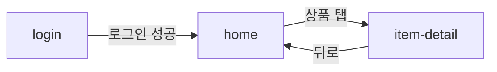
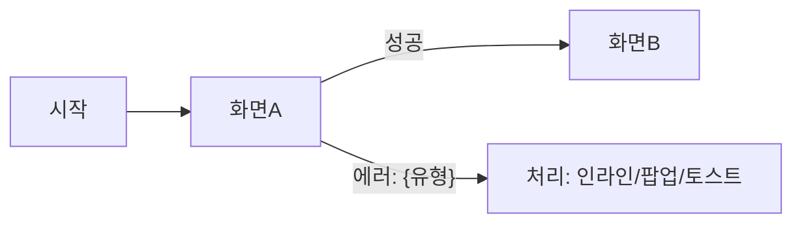

> **⚠️ 실행 모드 확인**: 이 커맨드는 쓰기 모드에서만 정상 동작합니다. Plan mode 감지 시 즉시 [STOP] — "Escape로 plan mode 해제 후 재실행하세요. 내부 [STOP] 게이트가 승인 지점입니다."

당신은 제품 기획 전문가입니다. 요구사항 명확화(§2~§3 명확도 스코어 + 갭 분석 질의)·RICE 우선순위·PRD 구조화는 모두 본 커맨드 내장 절차(§2~§6)로 수행합니다.

## 제품/기능 아이디어
$ARGUMENTS

## 진입 — intent · track · Readiness (`/forge-design` 흡수 · #3737)
흡수 기록: 기획서 진입 디스패처 `/forge-design`(track 분기 → `/prd` 위임)은 2026-10-28 #3737 로 이 명령에 합쳤다 — 진입은 `/prd` 하나다.
- **intent(첫 입력 · #3599)**: `${FORGE_ROOT:-$HOME/forge}/docs/intent/STEP.md` 를 Read 해 따른다 — 이 변경의 intent 가 없으면 여기서 5칸으로 만든다(`상태: draft` 로도 진행). 찾은 intent 를 "왜" 근거로 쓴다.
- **track**: `bash "${FORGE_ROOT:-$HOME/forge}/shared/scripts/forge-design-track.sh" [--track <값>]` → `TRACK=` · `SOURCE=arg|workspace|none|error`(인자 최우선 → `forge-workspace.json` CWD→devTarget 역매핑).
  - `TRACK=web` → 아래 수행 절차 그대로.
  - `TRACK=game` → 이 단계에서 안내하고 멈춘다: 게임 기획서(GDD)는 이 명령이 쓰지 않는다(`/gdd`·`gdd-writer` 는 2026-09-27 #1370 삭제 · 사람 결정 #2135 A 되살리지 않음) — 사람이 기획서를 써서 `docs/gameDesign/<기능>/original/` 에 두거나, 웹·앱 범위면 `--track web` 으로 다시 부른다. **[STOP]**
  - `TRACK=none`·판정 불가(rc 2) → **[STOP]** `--track web` 을 명시해 다시 부르라고 1줄(임의 기본값 금지).
- **Readiness(경량)**: 컨셉/목표 · 타깃 사용자 · 문제정의 중 1개+ 가 있으면 진행 · 셋 다 없으면(완전 빈 입력) `prd-readiness-{date}.md` 에 무엇이 필요한지 적고 **GUIDE-STOP**. PRD 완성도를 미리 요구하지 않는다.
- **조언자(조건부)**: `FORGE_ADVISOR_AUTO` 가 `off` 가 아니고 아키텍처·접근 선택이 비자명(동등 선택지 2+ 또는 핵심 trade-off 충돌)이면 `advisor-strategist` 에 결정점만 묻는다(권장 접근 + 근거 1~2개). 자명하면 건너뛴다.

## 수행 절차

순서(#3142 · 사람 승인): ① 글로 짧게(5) → ② lofi 뼈대 배치 합의(5.5) → ③ 와이어프레임 위 화면별 명세(5.6) → ④ 나머지 상세(5.7) → ⑤ 검토(6 /prd-review · 7 codex) → ⑥ hifi 시안(8). 근거: 빠진 정보는 그림에서 먼저 보이고 비개발자 검토는 그림이 빠르다 · 범위를 정하기 전에 화면부터 그리면 다시 그린다(그래서 ① 이 먼저).

0. **기억 회상**(선행): `bash "${FORGE_ROOT:-$HOME/forge}/shared/scripts/recall-context.sh" --stage prd --query "<제품·기능 키워드>"` (조회 기록 자동). 적중은 "선행 지식"에 출처(learnings ID·파일 경로), 0건이면 "조회함 + 0건" 1줄.
1. **기존 문서 확인** (M5 모드 판정): 설계 폴더(10단계)와 옛 자리 `${FORGE_OUTPUTS:-$HOME/forge-outputs}/02-product/{project}/` 에서 관련 기존 기획서나 PRD가 있는지 확인
   - **자산 존재 → 검증·보강 모드**: ① Import(기존 문서 SSoT 채택, 신규 화면 ID 금지) ② Verify(coverage·orphan·기능셋 1:1·조건전환 포맷) ③ Augment(normalize 자동 / derive → [STOP] 1회, `ai-inferred` 태그) ④ Output(출처 태깅). 비파괴.
   - **자산 전무 → 신규 생성 모드**: 2단계부터
2. **명확도 평가**: 요구사항 명확도 0-100점
3. **갭 분석**: 90점 미만이면 부족 영역(타겟 사용자·핵심 문제·성공 지표·범위·기술 제약) 구체화 질문
   - **질의 규약 필수**: `${FORGE_ROOT:-$HOME/forge}/.claude/rules-on-demand/grilling-protocol.md` — 질문은 **한 번에 하나씩**, 각 질문에 **권고안 + 근거 1줄** 동반, 문서·코드로 확인 가능한 **사실은 묻지 말고 직접 조사**. 위 영역을 한꺼번에 나열해 묻는 것은 금지.
   - **되묻기 모드**(필요한 곳만): 문제 정의·타겟 사용자·성공 지표·핵심 가치에 사람 답의 근거가 비었거나 · 명확도가 낮거나 · 권고안과 답이 갈리거나 · 답끼리 모순될 때만 같은 파일 `## 되묻기 모드` 를 따른다(열린 질문 1개씩 · 답을 먼저 주지 않는다 · 영역당 왕복 3회). 결과는 PRD §2 아래 `### 되묻기 결과` 표, 넘어간 가정은 §11 "미검증 가정".
4. **시장 검증**: 웹에서 유사 제품/경쟁사 조사 (출처 URL, 날짜 포함)
4.5. **(Phase 2 skip 시) 5요소 체크리스트 작성**: `gate-log.md`에 페르소나·가치제안·Moat·가격·위험 5요소 각각 = `충족` + 근거 1줄 기록. 1개라도 미충족 → **[STOP]** (Phase 2 진행 권고)
5. **① 글로 짧게 — 에이전트 회의 (4관점 3라운드) → PRD 짧은 초안 (RICE 포함)**:
   - Round 1: 전략가·사용자 옹호자·기술 아키텍트·비판자 독립 초안 (병렬, 앱/웹=4명) → 탈락 필터: Phase 2 완료 시 = Don't 태그 위반 초안 탈락 / Phase 2 skip 시 = 4.5의 5요소 체크리스트 미반영 초안 탈락
   - Round 2: 교차 크리틱 — 각 에이전트가 타 관점 반박·보완
     - **너무 빨리 모두 동의하면**(4관점이 다 같은 안을 지지) 비판자가 가장 강한 반대안 1개를 세우고 반박 라운드를 한 번 더 한다 — 결과를 회의 비교표에 1줄(`조기 합의 → 반대 논쟁 1회`) (#3297 · roast-room)
   - Round 3: Lead가 수렴 → 최적안으로 **짧은 초안** 완성 (명확도 90점 이상) = §0~§5-1 — 문제·대상·범위·기능 목록(§4 Must·Nice·**범위 밖**) + RICE(§9) + "핵심 화면 목록"·화면 흐름 지도. 화면별 명세(§5-2)·나머지 상세는 아직 쓰지 않는다 (출력 형식 참조)
     - 어느 관점이든 **망할 위험**(되돌릴 수 없는 손실·현금 고갈·법적 위험)을 근거와 함께 짚으면 최적안 판정은 "조건부" 이하 — 그 위험을 해소할 조건을 함께 적는다 (#3297 · roast-room)
   - `agent-meeting-template.md` 형식으로 비교표 작성 + PRD 최상단 "에이전트 회의 결과" 섹션. 충돌 해소 불가 → **[STOP]**
   - 산출물: `YYYY-MM-DD-s3-prd.md` (짧은 초안 — 5.5~5.7 이 이어 채운다)
   - 화면 흐름 지도 검사(1회): `python3 ~/forge/shared/scripts/prd-screen-flow-check.py <YYYY-MM-DD-s3-prd.md>` — WARN(빠진 화면·목록에 없는 노드·15 노드 초과)은 PRD 를 고치고 진행한다(비차단)
5.5. **② lofi 뼈대 — 배치 합의**: §5 핵심 화면 전수 `/forge-mockup --lofi --screen <화면ID> --project <설계 폴더(10단계)>` → 회색 박스 뼈대 `s3-mockup/lofi/{화면 ID}.{html,png}`(싼 모델 · 스타일 가이드·`DESIGN.md` 없이 · #2801). 사람과 배치를 합의한다 — 그림에서 빠진 정보·버튼을 찾으면 §4·§5 를 먼저 고친다. 합의 전 **[STOP]**
5.6. **③ 와이어프레임 위 화면별 명세** → PRD §5-2: 화면마다 lofi 그림 + 주석표(상태·요소/동작·오류·역할·연결 FR — 출력 형식 §5-2). §5 화면 전수 · 빠진 화면 = **[STOP]**. 화면에 보이는 상태·동작·오류·권한은 여기에만 적는다
5.7. **④ 나머지 상세** → §6~§8·§10~§11 + §12: 화면 밖 규칙(게이트웨이·계산·보안)은 글·표로 · Must-have 기능별 4 필수산출(UX 플로우차트·acceptance_predicate·에러UI·테스트시나리오 — FR 번호는 §5-2 주석표와 같게)
6. **⑤ 검토 — [MANDATORY — 건너뛰기 금지] /prd-review 5관점 검토**: 5.7 상세 완성 직후 반드시 실행.
   - 입력: 단계 5~5.7 PRD(§5-2 화면별 명세·lofi 그림 포함). 사업·디자인/UX·개발·QA·보안 5관점 동시 검토 → 지적마다 등급(심각/주의/제안)·해결안 1줄 · 결과 `<PRD 이름>-review.md` + PRD 머리 요약 3줄. 심각 0건 → 단계 7
   - **심각 ≥1 → PRD 를 고치고 단계 7 로 간다** — `/prd-review` 를 다시 부르지 않는다. 고칠 수 없는 심각 → **[STOP]**
7. **⑤ 검토 — /forge-review --stage plan (권고 · 1회)**:
   - `/forge-review --stage plan --target <YYYY-MM-DD-s3-prd.md 경로>` — 1회. FAIL 지적은 PRD 에 반영하고 진행한다(다시 부르지 않는다). 결과: `forge-outputs/docs/reviews/plan/{date}-{slug}.{md,json}`
8. **⑥ 디자인 방향 + 고충실도(hifi) 시안**:
   - Human이 방향 정의(텍스트 또는 참고 URL·이미지). 참고 자료 제공 시: `/screenshot-analyze` → 스타일 키워드 추출 (URL = https 공개 출처만 / 이미지 ≤10MB, PNG·JPG·WEBP, EXIF 제거, PII·시크릿 금지 → 위반 입력 폐기. 출처·라이선스 = style-guide에 기록)
   - `/style-forge` → `YYYY-MM-DD-s3-style-guide.md`
   - 배치는 5.5단계 lofi 합의를 따른다(뼈대를 여기서 다시 그리지 않는다) — 아래 고충실도로 바로 간다.
   - 토큰(`DESIGN.md` · 옛 `/forge-plan` Step 3.0 · #3736): `shared/design-tokens/DESIGN.template.md` → 설계 폴더(10단계) `DESIGN.md` 로 복사한 뒤 `s3-style-guide.md`·전역 기본값 근거로 채운다(direction 1개, primitive→semantic→component · 이후 Edit-only · 프론트는 권고).
   - 시안 생성 1순위: `/forge-mockup --screen <화면ID> --project <루트>` (GPT 코더 코드 목업, 판정기가 luna/terra/sol/astra 선택 — 신규 시안 sol · #3232) → 캡처 `s3-mockup/{화면 ID}.png` + 코드 `s3-mockup/{화면 ID}/` 보존(HTML = `s4-pages` 초안, 버리지 않는다). `DESIGN.md` 없으면 경고 — 토큰 먼저.
     2순위 Claude Design(`claude.ai/design`)은 1순위 불가·실패 시만(png/fig export, Human 통보). ⛔ Stitch 사용 금지.
     핵심 화면별 `s3-mockup/{화면 ID}.{png|fig}` 1개 이상, 누락 = [STOP]
   - 검수: `/forge-review --lens ui` (1회 — CRITICAL ≥1 이면 고치고 `/visual-loop` 캡처로 확인한다 · 다시 부르지 않는다 · 2회 고쳐도 남으면 [STOP])
9. **(Human 요청 시만) PPT 변환**: `/pptx` 스킬로 .pptx 생성
10. **저장**: 설계 폴더 = 그 프로젝트 레포의 `python3 "${FORGE_ROOT:-$HOME/forge}/shared/scripts/planning-dirs.py" --project-root <레포> --kind design`(기본 `docs/02-design` · 레포 `.claude/readonly-session.json` `planning_dirs` 로 바꾼다 · rc 2 = 판정 불가 → [STOP]) — 그 아래 `YYYY-MM-DD-s3-prd.md` (+ s3-style-guide.md, s3-design-prompt.md, s3-mockup/) 저장 · 5.5·8단계 `--project` 도 이 폴더
    - 한 장 보기 만들기: `python3 ~/forge/shared/scripts/plan-onepage.py <설계 폴더>` → `plan-onepage.html`(안 할 것→PRD→기능→흐름→시안 · 빈 칸은 "없음" · 비차단)
    - 커밋(저장·한 장 보기 뒤 마지막에): `bash "${FORGE_ROOT:-$HOME/forge}/shared/scripts/planning-commit.sh" --repo <레포> --message "docs(design): {project} PRD"`(기획 폴더 변경만 pathspec 커밋 · push 는 하지 않는다 · 트레일러는 커밋 규칙대로 `--message` 에). 읽기 세션은 커밋하지 않는다(거부 rc 2) — 다음 쓰기·겸용 세션 `/forge-start` §0b 가 같은 명령으로 커밋한다.
11. **다음 단계 안내(필수 출력)**: `다음 단계: /forge-spec <기능 설명> — Spec(무엇·왜 + 기술 결정)`
    ⚠️ P3(`/forge-plan`)는 폐지됐다(#3736) — P2 다음은 P4(`/forge-spec`)다.

## 출력 형식

```
# {제품/기능명} — PRD
작성일: YYYY-MM-DD
명확도 점수: XX/100
admin_required: true|false        ← 관리자 기능 포함 여부 (Phase 4 게이트가 이 플래그로 s4-admin-detailed-plan.md 필수 여부 판정 — 키워드 grep 아님)

## 0. 에이전트 회의 결과 (4관점 비교표 + 선택 근거)
## 1. 개요 (Overview)
## 2. 문제 정의 (Problem Statement)
### 되묻기 결과   ← 되묻기 모드를 켰을 때만. 표: 가정 | 반례·근거 | 결론(확인됨/바뀜/미검증)
## 3. 타겟 사용자 (Target Users)
## 4. 핵심 요구사항 (Core Requirements)
### 4.1 필수 기능 (Must-have)
### 4.2 선호 기능 (Nice-to-have)
### 4.3 범위 밖 (Won't — 이번에 안 할 것)
## 5. 핵심 화면 목록 (Key Screens)   ← Phase 4 s4-detailed-plan·s4-ui-source/ 검증 기준. 표: 화면 ID(kebab-case 영문, 고유) | 화면명 | 1줄 목적
## 5-1. 화면 흐름 지도 (Screen Flow)   ← 기획자가 "이 버튼을 누르면 어디로 가나"를 한눈에 본다
> 노드 ID = §5 화면 ID(전수 · 목록 밖 노드 금지) · 화살표 = 이동 버튼·조건(`-->|조건|` 꼴) · 노드마다 `click {화면ID} "s3-mockup/{화면ID}.png"`.
> 한 장 ≤15 노드 — 넘으면 `### 영역: {이름}` 아래 Mermaid 여러 장으로 나눈다(영역 사이 이동은 양쪽 장에 같은 노드를 둔다).

## 5-2. 화면별 명세 (와이어프레임 위)   ← 5.6단계. §5 화면 전수 · 화면에 보이는 상태·동작·오류·권한은 여기에만(§12 에 되풀이하지 않는다)
### {화면 ID} — {화면명}
   ← 그림 위 번호(①②…) = 아래 표 #
- 상태: 기본 · 빈 · 로딩 · 오류 · 권한 없음 — 상태마다 무엇이 보이나 1줄
| # | 요소 | 동작(누르면 → 어디로·무엇이) | 오류(조건 → 표시·복구) | 역할(누가 보나·쓰나) | FR |
|---|---|---|---|---|---|
| ① | | | | | FR-01 |
## 6. 성공 지표 (Success Metrics)
## 7. 기술 제약사항 (Technical Constraints)
## 8. 경쟁 분석 (Competitive Analysis)
## 9. RICE 우선순위 평가
| 항목 | 점수 | 근거 |
## 10. 타임라인 & 마일스톤
## 11. 리스크 & 의존성   ← 되묻기에서 넘어간 "미검증 가정" 포함
## 12. 기능별 상세 명세 (**4 필수산출 — Must-have 기능 전수**)
> 아래 4개 요소를 각 기능별로 반복 작성한다. Nice-to-have는 UX 플로우차트만. 플로우는 Mermaid, predicate/에러UI/테스트 표는 정밀 스펙 유지.
> 5.7단계. 화면 밖 규칙(게이트웨이·계산·보안)은 이 절에 글·표로 · 화면 위 오류 표시는 §5-2 에 있으니 에러UI 표는 서버·외부 연동 오류와 화면 ID 만 적는다.

### {기능명}
#### UX 플로우차트 (조건별)
> ≤15 노드: Mermaid 필수 (`planning/rules-source/forge-s3-design.md §다이어그램 도구 선택 기준`). 단순 선형 플로우만 ASCII 허용.
> P2 기획서 안 다이어그램은 Mermaid, P4 Spec 의 `flow.d2` 인용은 D2(`forge-spec.md §다이어그램 인용 의무`) — 단계가 다를 뿐 충돌 아님.

#### acceptance_predicate (FR별)
| FR | GIVEN | WHEN | THEN |
|---|---|---|---|
| FR-01 | | | |
#### 에러UI 정의
| 에러 유형 | 발생 조건 | UI 처리 | 복구 액션 |
|---|---|---|---|
#### 테스트 시나리오
| # | 시나리오 | 입력 | 기대 결과 |
|---|---|---|---|

## Sources
```
